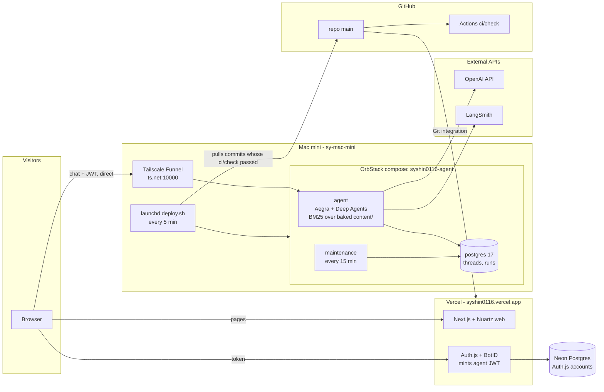

# Infrastructure overview

## Components

| Part | Runs on | Notes |
| --- | --- | --- |
| Web, blog, chat UI | Vercel | Next.js 16 + Nuartz. Deploys on every push to `main` through the Vercel Git integration |
| Sign-in | Vercel + Neon | Auth.js v5 with GitHub/Google; accounts in Neon ([web-auth.md](../runbooks/web-auth.md)) |
| Agent JWT | Vercel | HS256, signed with `AGENT_AUTH_SECRET`; guests get a 300 s `anon` token behind BotID |
| Public agent origin | Mac mini | Tailscale Funnel `https://sy-mac-mini.tail8d4638.ts.net:10000` → `127.0.0.1:18080` |
| Agent | Mac mini (OrbStack) | Aegra + Deep Agents; the image bakes `content/` and builds the BM25 index ([chat-runtime.md](chat-runtime.md)) |
| Agent database | Mac mini (OrbStack) | Local Postgres 17 volume; no off-host backup yet |
| Guest cleanup | Mac mini (OrbStack) | `maintenance` service, every 15 minutes |
| Agent deploy | Mac mini (launchd) | `deploy.sh` every 5 minutes, only for `main` commits whose `ci/check` passed ([home-server-delivery.md](../runbooks/home-server-delivery.md)) |
| Model, tracing | OpenAI, LangSmith | `openai:gpt-6-luna` for owner and guest runs |
| Former agent host | GCP Cloud Run | Dormant while GCP billing is off ([cloud-run-delivery.md](../runbooks/cloud-run-delivery.md)) |

Kaneo (`:443`) and the statusboard (`:8443`) share the Mac mini and its Tailscale name
but stay tailnet-only; only `:10000` is on Funnel.

## A chat request

1. The browser asks Vercel for a token. Guests pass BotID first; signed-in users use
   their Auth.js session.
2. The browser sends the run straight to the Funnel origin with that JWT. Vercel is not
   in the request path.
3. The agent verifies the JWT with the same `AGENT_AUTH_SECRET`, searches the baked
   corpus, and calls OpenAI.
4. Threads and runs land in the Mac mini Postgres.

A `401` on `POST /threads` from a real browser usually means the two
`AGENT_AUTH_SECRET` values differ. Pipe the Vercel value with `printf %s` so no
trailing newline is stored, then redeploy the web.

## Cost

Only the OpenAI API bills per use. Guest runs share a daily cap of 500000 micro-USD
($0.50). Each signed-in account has its own daily cap, `SIGNED_IN_DAILY_BUDGET_MICRO_USD`
(default 5000000, $5): a run starts only while the account's spend for the UTC day is
below the cap, and each finished run adds its priced provider usage. Runs already in
flight when an account crosses the cap still finish, so keep a monthly usage limit in the
OpenAI dashboard as the hard stop. Vercel, Neon, Tailscale Funnel, and GitHub Actions run
within free tiers.

## Not yet in place

- `syshin0116.dev` is not registered, so the site uses `vercel.app` and `ts.net`
  addresses. With a domain, move the agent origin to Cloudflare Tunnel.
- No off-host backup for the Mac mini Postgres.
