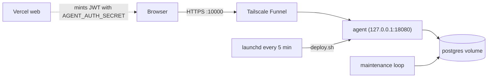

# Home-server agent delivery runbook

Since 2026-11-15 the production agent runs on the Mac mini (`ssh sy-mac-mini`) instead of
Cloud Run, which is dormant while GCP billing is off ([cloud-run-delivery.md](cloud-run-delivery.md)).



## Layout on the server

| Path | Contents |
| --- | --- |
| `~/srv/syshin0116.dev` | Detached checkout of the deployed `origin/main` revision |
| `~/srv/agent/.env` | `POSTGRES_PASSWORD`, `AGENT_PORT` (from `infra/home-server/dot-env.example`), mode 600 |
| `~/srv/agent/agent.env` | Runtime env (from `infra/home-server/agent.env.example`), mode 600 |
| `~/srv/agent/deploy.sh` | Copy run by launchd; each deploy refreshes it from the repo |
| `~/srv/agent/deployed-sha`, `deploy.log` | Last deployed revision and the deploy log |

The stack mirrors the former Cloud Run production map: one uvicorn worker, Redis off,
the guest launch tuple (`openai:gpt-6-luna`, 500000, 53837), and the guest maintenance
job as a 15-minute loop in the `maintenance` service. One Postgres role owns the database;
the Neon runtime/migration role split does not apply here.

## Deploy

`deploy.sh` runs every 5 minutes. It does nothing unless `origin/main` moved and that
commit's `ci/check` concluded `success`. Then it builds the image tagged with the short SHA,
runs `migrate`, replaces `agent` and `maintenance` with `--wait`, and smoke-tests `/live`,
`/ready`, and an unauthenticated `POST /threads` that must return `401`.

Run it by hand with `~/srv/agent/deploy.sh`. `--force` skips the `ci/check` gate and
redeploys the current revision; use it only for recovery.

A failed migration leaves the previous agent serving. A new image that fails its health
check is already in place, so roll back:

```bash
cd ~/srv/agent
docker image ls syshin0116-agent        # the three newest tags are kept
AGENT_IMAGE_TAG=<previous> docker compose -f ~/srv/syshin0116.dev/infra/home-server/compose.yaml \
  --project-directory ~/srv/agent up -d --wait agent maintenance
```

Rolling back across a schema migration is not supported; fix forward instead.

## Public origin

`tailscale funnel --bg --https=10000 http://127.0.0.1:18080` publishes
`https://sy-mac-mini.tail8d4638.ts.net:10000`. Ports 443 and 8443 on the same name serve
tailnet-only apps and must stay off Funnel. Vercel Production and Preview set
`NEXT_PUBLIC_AGENT_API_URL` to this origin; changing it needs a web redeploy because the
value is inlined at build time. Move to a custom domain (Cloudflare Tunnel) once one is
registered.

## Secrets

`AGENT_AUTH_SECRET` in `agent.env` must equal Vercel Production `AGENT_AUTH_SECRET`
(a sensitive variable, so it cannot be read back). To rotate, generate one value, write it
to both, then `deploy.sh --force` and redeploy the web. Old Cloud Run secrets in GCP Secret
Manager are unreachable while billing is off and are no longer used.

## Verify

```bash
curl -fsS https://sy-mac-mini.tail8d4638.ts.net:10000/ready
ssh sy-mac-mini 'cd ~/srv/agent && docker compose -f ~/srv/syshin0116.dev/infra/home-server/compose.yaml --project-directory . ps'
```

A real chat on https://syshin0116.vercel.app is the end-to-end check. Headless browsers get
`403` from the BotID-gated token route, which is expected.

## Known gaps

- No off-host Postgres backup yet; guest threads expire anyway, signed-in threads do not.
- A reboot restarts the stack (`restart: unless-stopped`, OrbStack at login), but Funnel
  and launchd need the user session; enable auto-login on the Mac mini.
